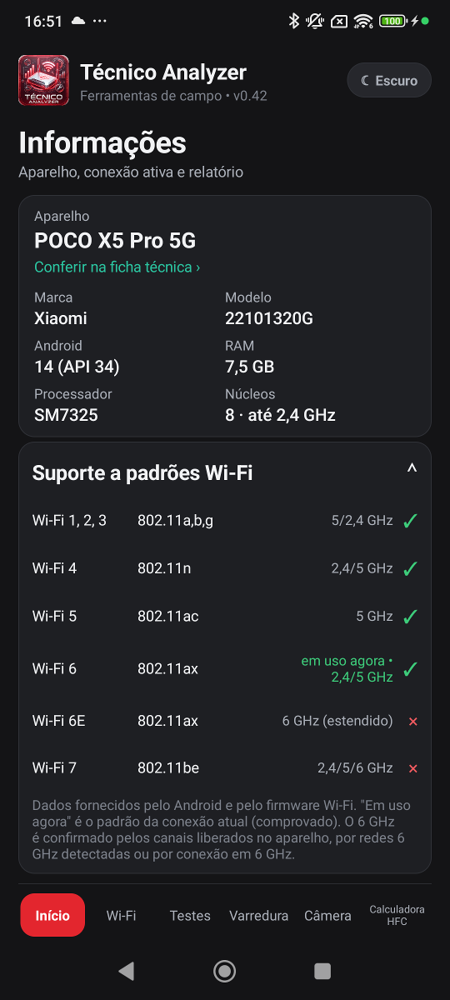
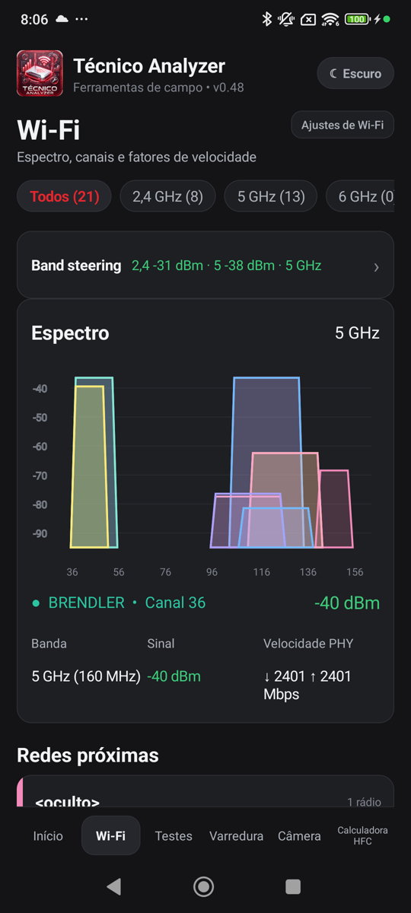
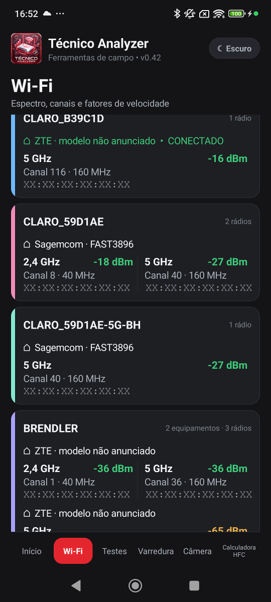
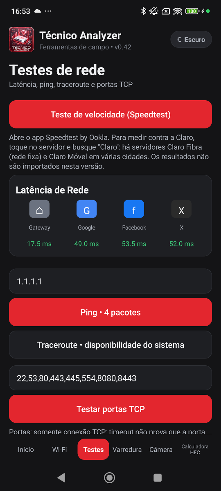
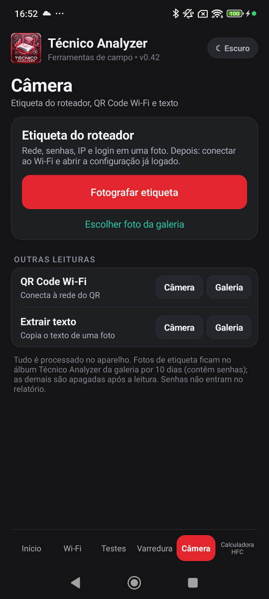
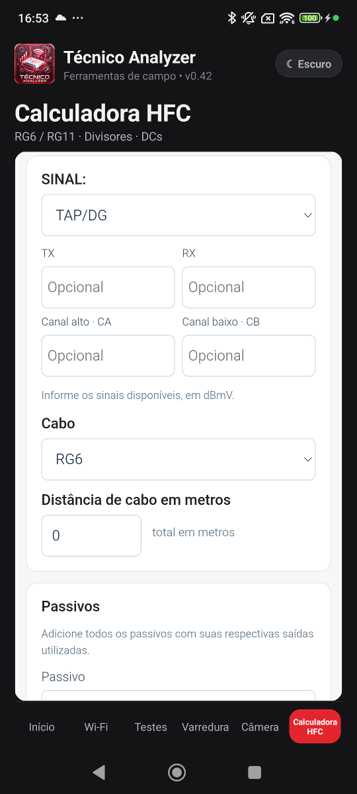
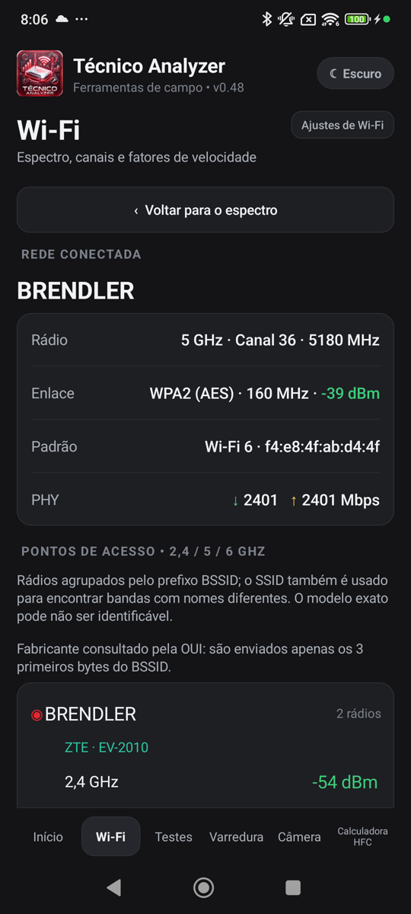

# Técnico Analyzer · Download

Ferramentas de campo para técnicos de instalação e manutenção (Android 11+).

**[Página de download](https://fbrendler.github.io/tecnico-analyzer-download/)** ·
**[Baixar a versão mais recente (APK)](https://github.com/fbrendler/tecnico-analyzer-download/releases/latest/download/tecnico-analyzer.apk)**

| Início | Wi-Fi · espectro | Wi-Fi · redes |
|:-:|:-:|:-:|
|  |  |  |
| **Testes** | **Câmera** | **Calculadora HFC** |
|  |  |  |

**Band steering:** 

Este repositório contém só os arquivos publicados (APK nas [Releases](https://github.com/fbrendler/tecnico-analyzer-download/releases) e a página de download). O código-fonte é privado.

by BRENDLER™
